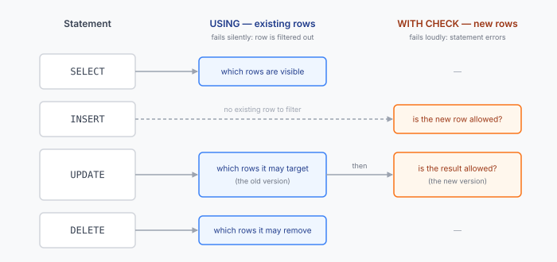
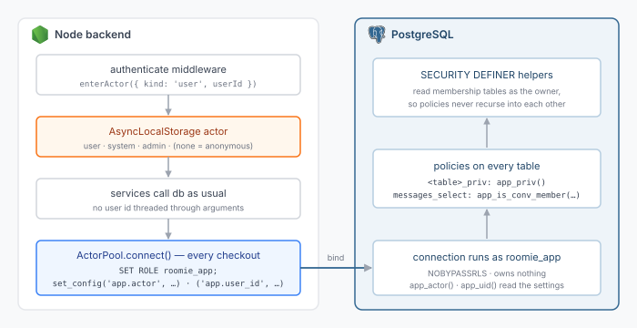

Every multi-user application has a rule like *"a user can only read messages in conversations they belong to."* In most codebases that rule lives in a `WHERE` clause — and it lives there in every query that touches the table. The route that lists messages has it. The route that searches messages has it. The export job has it. The one written in a hurry last Thursday probably has it.

The day one of them doesn't, you have an IDOR bug: change an id in a URL and you're reading someone else's data. No amount of code review makes "remember the filter in every query, forever" a reliable control.

PostgreSQL's **row-level security** (RLS) moves that rule out of the queries and into the table. You declare once, in the database, which rows a given caller may see or change, and Postgres appends that condition to *every* statement against the table — including the ones you forgot to filter.

This post covers the fundamentals for someone who has never written `CREATE POLICY`, then shows how I use it in Roomie, a roommate-matching app I'm building, where it sits underneath an ordinary Node/Express backend as a second line of defence.

---

## The problem RLS solves

Ordinary Postgres privileges (`GRANT SELECT ON messages TO app`) are all-or-nothing per table: if the role can read `messages`, it can read *every* message. Authorization below table level — *this* row yes, *that* row no — has traditionally been the application's job.

RLS adds a row-level filter to the privilege system:

- **Table privileges** answer *"may this role touch this table at all?"*
- **Row policies** answer *"which rows of it?"*

Both have to pass. RLS doesn't replace `GRANT`; it narrows it.

Typical uses:

- **Multi-tenant SaaS** — one schema, many customers, `tenant_id` on every row, and a guarantee that tenant A never sees tenant B's rows.
- **User-owned data** — profiles, messages, documents, tokens that only their owner (or a group they belong to) may read.
- **Direct database access from clients** — this is how Supabase and PostgREST work: the browser effectively talks to Postgres, so the database *must* enforce authorization.
- **Defence in depth** — the application still does its own checks, and RLS catches the ones it misses. That's my use case.

---

## Turning it on

RLS is off by default on every table. Enabling it is one statement:

```sql
ALTER TABLE messages ENABLE ROW LEVEL SECURITY;
```

The moment you run this, and *before you write any policy*, the table becomes **default-deny**: a role subject to RLS sees zero rows, and its inserts fail. No policy means no access. This is the property that makes RLS a safety net rather than a feature you have to remember — a forgotten policy fails closed.

Then you grant access back, row by row, with policies:

```sql
CREATE POLICY messages_select ON messages
  FOR SELECT
  USING (conversation_id IN (
    SELECT conversation_id FROM conversation_members
     WHERE user_id = current_setting('app.user_id')::uuid
  ));
```

From now on, for a role subject to RLS:

```sql
-- only messages in my conversations
SELECT * FROM messages;

-- an id from someone else's chat: 0 rows, no error
SELECT * FROM messages WHERE id = $1;
```

Nothing changed in the query. Postgres rewrote it to include the policy, as if you'd written `WHERE (<your filter>) AND (<policy>)`.

(We'll fix that subquery later — it has a problem — but it shows the idea.)

---

## USING vs WITH CHECK

A policy has two possible expressions, and this distinction is the most important thing to understand about RLS:

- **`USING (…)`** filters **existing rows** — the ones a statement *reads* or *targets*. It applies to `SELECT`, and to the rows an `UPDATE` or `DELETE` is allowed to touch.
- **`WITH CHECK (…)`** validates **new row versions** — what an `INSERT` writes, or what a row looks like *after* an `UPDATE`.

<figure>
  <picture style="display:block">
    <source media="(max-width: 640px)" srcset="/assets/images/postgres-rls/diagram-using-vs-check-mobile.svg">
    
  </picture>
  <figcaption>USING decides which existing rows a statement can see or target. WITH CHECK decides whether the row it is about to write is allowed. UPDATE goes through both: the old row must pass USING, the new one WITH CHECK.</figcaption>
</figure>

They also fail differently, and that surprises people:

| Statement | Checked by | If it fails |
|---|---|---|
| `SELECT` | `USING` | row is hidden |
| `DELETE` | `USING` | row is skipped (`DELETE 0`) |
| `UPDATE`, old row | `USING` | row is skipped (`UPDATE 0`) |
| `UPDATE`, new row | `WITH CHECK` | **error** |
| `INSERT` | `WITH CHECK` | **error** |

The error is `new row violates row-level security policy for table "…"`.

Reads filter, writes fail. An `UPDATE` against a row you can't see doesn't raise anything — it just affects zero rows — so your application should treat "0 rows affected" as "not found."

Why have both? Because they protect against different things. Consider a messages table:

```sql
CREATE POLICY messages_insert ON messages
  FOR INSERT
  WITH CHECK (sender_user_id = current_setting('app.user_id')::uuid);
```

Without that check, a member of a conversation could insert a message with `sender_user_id` set to someone else — spoofing the sender. `USING` can't express this, because there is no existing row yet. And for `UPDATE`, `WITH CHECK` stops a user from editing their own row *into* a row they shouldn't own, for example by changing `user_id` to another user's id.

If you write an `UPDATE` (or `ALL`) policy with only `USING`, Postgres uses the same expression as `WITH CHECK` too. That default is usually what you want for ownership rules.

---

## Policies combine: permissive and restrictive

A table can have many policies, per command (`SELECT`, `INSERT`, `UPDATE`, `DELETE`, or `ALL`) and per role (`TO some_role`, default `PUBLIC`). They combine like this:

- **Permissive** policies (the default) are **OR**ed. A row is allowed if *any* permissive policy allows it.
- **Restrictive** policies (`AS RESTRICTIVE`) are **AND**ed on top. A row must pass *every* restrictive policy.
- At least one permissive policy must pass. Restrictive policies on their own grant nothing.

```sql
-- permissive: owners see their documents
CREATE POLICY docs_owner ON documents FOR SELECT
  USING (owner_id = current_setting('app.user_id')::uuid);

-- permissive: shared documents too
CREATE POLICY docs_shared ON documents FOR SELECT
  USING (visibility = 'everyone');

-- restrictive: ...but never soft-deleted ones, whichever rule let you in
CREATE POLICY docs_live ON documents AS RESTRICTIVE FOR SELECT
  USING (deleted_at IS NULL);
```

The effective filter is `(docs_owner OR docs_shared) AND docs_live`.

The practical rule: model **who may access** with permissive policies (each one adds a way in), and model **global constraints** that must always hold with restrictive ones (tenant isolation is the classic case: a restrictive `tenant_id = current_tenant()` guarantees no permissive policy can accidentally leak across tenants).

---

## Who RLS applies to, and who it doesn't

This is where most RLS setups that "don't work" go wrong. RLS is **skipped** for:

1. **Superusers.** Always. No exceptions.
2. **Roles with the `BYPASSRLS` attribute.**
3. **The table's owner** — unless you `ALTER TABLE … FORCE ROW LEVEL SECURITY`.

The third one bites hardest. In a typical app, migrations run as some role, that role creates the tables, so it *owns* them — and if the app connects as that same role, every policy you wrote is ignored. Your tests pass because they see everything, and nothing is being enforced.

You have two ways out:

- **Connect the app as a different role** that owns nothing and has `NOBYPASSRLS`. Policies bind it.
- **`FORCE ROW LEVEL SECURITY`** on each table, so even the owner is subject to it. (Superusers still bypass.)

The first is cleaner: the role that runs migrations and the role that serves traffic should be different things anyway.

```sql
CREATE ROLE app_user LOGIN PASSWORD '…' NOBYPASSRLS;
GRANT SELECT, INSERT, UPDATE, DELETE
  ON ALL TABLES IN SCHEMA public TO app_user;
```

Two more related things worth knowing:

- **Foreign-key and unique checks are not filtered by RLS.** Postgres must check referential integrity against all rows, so a user can learn that a row *exists* (an insert fails with a unique violation, or a foreign key succeeds) without being able to read it. RLS hides contents, not existence. Don't put secrets in primary keys.
- **Views run with their owner's permissions by default**, so a view owned by a bypassing role leaks through RLS. On Postgres 15+ create views `WITH (security_invoker = true)` so they're evaluated as the caller.

---

## Telling Postgres who the user is

Policies need to know who is asking. If every end user had their own database role, you could use `current_user`. Web apps don't work that way: thousands of users share a pool of connections that all log in as the same role.

The standard technique is a **custom session setting** — any setting with a dotted name is allowed — which the application sets per request and policies read:

```sql
-- the app, at the start of the unit of work
SELECT set_config('app.user_id', '7c0e…', true);

-- a policy
USING (owner_id = current_setting('app.user_id', true)::uuid)
```

Two details matter:

- **`current_setting(name, true)`** — the second argument (`missing_ok`) returns `NULL` instead of raising when the setting isn't set. `owner_id = NULL` is never true, so an unset user sees nothing: fail closed.
- **`set_config(name, value, is_local)`** — with `is_local = true` the value lasts only until the end of the current transaction (same as `SET LOCAL`); with `false` it lasts for the session, i.e. the connection.

That second point is where connection pools come in. A pooled connection is reused by the next request. If request A sets `app.user_id` for the session and request B gets the same connection without setting it, **B runs as A**. There are two safe patterns:

1. **Transaction-scoped:** wrap each unit of work in a transaction and use `SET LOCAL` / `set_config(…, true)`. The value cannot outlive the transaction. This is the only safe option behind PgBouncer in transaction mode, where consecutive transactions on "your" connection may come from different clients.
2. **Overwrite on every checkout:** if your app owns the pool, set the values *every time* a connection is handed out — including resetting them to empty for anonymous callers — so the previous holder's identity is always overwritten.

Supabase's `auth.uid()` is exactly this: a function that reads a JWT claim out of a setting PostgREST puts in each transaction.

---

## Writing policies that don't hurt

### Membership checks: use SECURITY DEFINER helpers

Back to the subquery from the start:

```sql
USING (conversation_id IN (
  SELECT conversation_id FROM conversation_members WHERE user_id = …))
```

If `conversation_members` *also* has RLS — and it should — then that subquery is itself filtered by `conversation_members`' policies. Depending on what those say, you get rows silently missing, or `infinite recursion detected in policy` if the two tables' policies refer to each other.

The fix is to put the membership question in a function marked `SECURITY DEFINER`, which runs with the rights of its owner (the table owner, who bypasses RLS):

```sql
CREATE FUNCTION is_conv_member(conv uuid) RETURNS boolean
LANGUAGE sql STABLE SECURITY DEFINER
SET search_path = public, pg_temp
AS $$
  SELECT EXISTS (
    SELECT 1 FROM conversation_members
     WHERE conversation_id = conv
       AND user_id = current_setting('app.user_id', true)::uuid)
$$;

CREATE POLICY messages_select ON messages FOR SELECT
  USING (is_conv_member(conversation_id));
```

The `SET search_path` is not optional. A `SECURITY DEFINER` function without it resolves table names using the *caller's* search path, so a caller who can create objects could plant their own `conversation_members` in a schema earlier in the path and have your privileged function read it.

These helpers are also simply nicer: policies read like the product's rules (`is_conv_member(id)`, `is_apartment_admin(apt)`) and the logic is written once.

### Performance: wrap per-query values in a subselect

A policy expression is, logically, evaluated for each row. For `owner_id = current_user_id()` on a big table, that's one function call per row scanned. Wrapping it in a scalar subquery lets the planner compute it once per query (an *InitPlan*) and use an index on `owner_id` normally:

```sql
USING (owner_id = (SELECT current_user_id()))
```

Same result, very different plan on large tables. And as with any `WHERE` clause: index the columns your policies filter on (`owner_id`, `tenant_id`, `conversation_id`). A policy is a predicate added to every query; an unindexed one is a sequential scan added to every query.

### Watch out for INSERT … RETURNING

`RETURNING` reads the new row back, so the row must pass the table's **SELECT** policy as well as the INSERT one. This catches out "create" flows where the creator isn't yet allowed to see what they just created. The classic case: a user creates a conversation, but the SELECT policy says "members only," and they don't become a member until the *next* insert. The `INSERT … RETURNING id` fails even though the INSERT policy allowed it. You need either a bootstrap rule or a trusted step to cover that gap. I hit exactly this; more below.

---

## How I use it in Roomie

Roomie is a Node/Express API with Drizzle on Postgres 18. Users belong to shared flats (`apartments`), chat in conversations, split expenses, apply to listings; agencies and landlords manage properties. A lot of *"only members of X may see Y."*

The application layer already authorizes everything: routes authenticate, services check membership. RLS is there for the query that someone, someday, writes without the right `WHERE`. It's defence in depth, not the primary control — and it's not a sandbox against SQL injection either.

<figure>
  <picture style="display:block">
    <source media="(max-width: 640px)" srcset="/assets/images/postgres-rls/diagram-roomie-flow-mobile.svg">
    
  </picture>
  <figcaption>The request's identity travels in AsyncLocalStorage, not through function arguments. The pool turns it into a role and two session settings on every checkout, and the policies take it from there.</figcaption>
</figure>

### A role that owns nothing

Migrations run as the owning role. The app switches into `roomie_app` — a `NOLOGIN NOBYPASSRLS` role that owns no tables — so policies bind it:

```sql
CREATE ROLE roomie_app NOLOGIN NOBYPASSRLS;
GRANT roomie_app TO CURRENT_USER;   -- the app's login may SET ROLE into it
GRANT SELECT, INSERT, UPDATE, DELETE
  ON ALL TABLES IN SCHEMA public TO roomie_app;
ALTER DEFAULT PRIVILEGES IN SCHEMA public
  GRANT SELECT, INSERT, UPDATE, DELETE ON TABLES TO roomie_app;
```

The tables are *not* `FORCE`d: migrations and DB maintenance, running as the owner, bypass policies on purpose.

### Three kinds of actor, not just a user id

A plain `app.user_id` wasn't enough, because not every database call is made on behalf of an end user. Workers, webhooks and the sign-in flow are trusted backend code; the admin console is its own thing. So there are two settings, read through small helpers:

```sql
-- 'user' | 'system' | 'admin'; anything else (incl. unset) = 'anon'
CREATE FUNCTION app_actor() RETURNS text LANGUAGE sql STABLE AS $$
  SELECT COALESCE(
    NULLIF(current_setting('app.actor', true), ''), 'anon')
$$;

CREATE FUNCTION app_uid() RETURNS uuid LANGUAGE sql STABLE AS $$
  SELECT CASE WHEN app_actor() = 'user'
    THEN NULLIF(current_setting('app.user_id', true), '')::uuid
  END
$$;

CREATE FUNCTION app_priv() RETURNS boolean LANGUAGE sql STABLE AS $$
  SELECT app_actor() IN ('system', 'admin')
$$;
```

Membership questions are `SECURITY DEFINER` helpers, as described above — `app_is_apartment_member(apt, admin_only)`, `app_is_conv_member(conv)`, `app_is_agency_member(...)` and so on.

### Every table gets a policy, shaped the same way

Every table has RLS enabled and a `<table>_priv` policy that lets `system`/`admin` through; everything else is what a `user` actor may do. Tables with no user policy are system-only, and an anonymous caller sees only the public product catalogue. Messages, for instance:

```sql
ALTER TABLE messages ENABLE ROW LEVEL SECURITY;

CREATE POLICY messages_priv ON messages
  USING (app_priv()) WITH CHECK (app_priv());

CREATE POLICY messages_select ON messages FOR SELECT
  USING (app_is_conv_member(conversation_id));

CREATE POLICY messages_insert ON messages FOR INSERT
  WITH CHECK (sender_user_id = (SELECT app_uid())
              AND app_is_conv_member(conversation_id));
```

No UPDATE or DELETE policy for users — so users can't edit or delete messages directly through SQL at all; only trusted code can. And the `WITH CHECK` stops a member from posting as someone else.

Flats show the admin/member split:

```sql
CREATE POLICY apartments_update ON apartments FOR UPDATE
  USING (app_is_apartment_member(id))
  WITH CHECK (app_is_apartment_member(id));

CREATE POLICY apartments_delete ON apartments FOR DELETE
  USING (app_is_apartment_member(id, true));   -- admins only
```

### Getting the identity onto the connection

On the Node side, the acting identity lives in `AsyncLocalStorage`, so it follows the request through every `await` without being passed as an argument:

```ts
export type DbActor =
  | { kind: 'user'; userId: string }
  | { kind: 'system' }
  | { kind: 'admin' };

const store = new AsyncLocalStorage<DbActor>();

export const currentActor = () => store.getStore();

export const runAsSystem = <T>(fn: () => T): T =>
  store.run({ kind: 'system' }, fn);

export function enterActor(actor: DbActor): void {
  store.enterWith(actor);
}
```

The auth middleware sets it after verifying the token, and services keep calling `db` exactly as before:

```ts
req.user = { id: payload.id, email: payload.email };
// From here on, DB access in this request runs as this user.
enterActor({ kind: 'user', userId: payload.id });
```

The pool does the rest. I subclass `pg`'s `Pool` and override `connect()`, so every checkout — plain queries and `db.transaction()` alike — is bound to whoever is in scope *at that moment*:

```ts
async function bindActor(client: PoolClient, actor?: DbActor) {
  const kind = actor?.kind ?? '';
  const userId =
    actor?.kind === 'user' && UUID_RE.test(actor.userId)
      ? actor.userId
      : '';
  // a 'user' with a malformed id becomes anonymous
  const safeKind = actor?.kind === 'user' && !userId ? '' : kind;
  await client.query(
    `SET ROLE roomie_app;
     SELECT set_config('app.actor', '${safeKind}', false),
            set_config('app.user_id', '${userId}', false)`,
  );
}

class ActorPool extends Pool {
  connect(cb?) {
    // read synchronously, in the caller's async context
    const actor = currentActor();
    // ...super.connect(), then bindActor(client, actor)
    //    before the client is handed out
  }
}
```

This is the "overwrite on every checkout" pattern from earlier: session-scoped settings, but rewritten every time a connection leaves the pool — including to empty for anonymous callers — so one request's identity can never leak into the next. Doing it in one multi-statement query keeps it to a single round trip; that means no bind parameters, which is why the values are only interpolated after validation (a fixed enum and a strict UUID regex).

Enforcement is always on. Code that runs with no actor in scope is anonymous and sees nothing, so a new entry point — a route group, a worker, a one-off script — that forgets to declare an actor fails loudly the first time it runs instead of quietly running with too much access.

### The `system` escape hatch, used narrowly

Some operations legitimately cross user boundaries: notifying another user, matching *other people's* saved searches against a new listing, billing bookkeeping. Those service functions are wrapped so they always run as `system`:

```ts
export function systemScoped<A extends unknown[], R>(
  fn: (...args: A) => R,
) {
  return (...args: A): R => runAsSystem(() => fn(...args));
}
```

`system` bypasses every row policy, so a function wrapped like this has to authorize the caller itself. They're few, they're greppable, and that's the point: the places that can see across users are explicit.

### Testing that the policies actually hold

Policies are code, and untested policies rot. The DB test suite runs each test inside a transaction that's rolled back, seeds data as the owner, then switches into the real role:

```ts
export async function actAs(c: PoolClient, a: Actor) {
  await c.query('SET LOCAL ROLE roomie_app');
  await c.query(
    `SELECT set_config('app.actor', $1, true),
            set_config('app.user_id', $2, true)`,
    [a.kind === 'anon' ? '' : a.kind, a.kind === 'user' ? a.userId : ''],
  );
}
```

Tests read like the product's rules — *"only members read messages; the sender cannot be spoofed,"* *"KYC data is visible only to its owner,"* *"draft listings are hidden from the public but visible to their poster."* And one test guards the whole idea:

```ts
it('every public table has RLS enabled', () =>
  withTx(async (c) => {
    const r = await rows(c, `
      SELECT c.relname
        FROM pg_class c
        JOIN pg_namespace n ON n.oid = c.relnamespace
       WHERE n.nspname = 'public' AND c.relkind = 'r'
         AND NOT c.relrowsecurity
         AND c.relname <> 'spatial_ref_sys'`);
    // a new table without RLS fails this test
    expect(r.map((x) => x.relname)).toEqual([]);
  }));
```

Add a table, forget RLS, CI fails. The suite runs as a **non-superuser**, because a superuser run hides exactly the class of bug RLS is supposed to catch.

### What the first test run found

The first time those tests ran, they found real bugs — in the policies themselves:

- **`INSERT … RETURNING` on a brand-new conversation failed.** The creator isn't a member yet, so the SELECT policy hid the row they'd just inserted. The fix is a narrow bootstrap rule — a conversation with *no* members is visible and joinable, which is true only for the instant between its creation and its first member — implemented as a `SECURITY DEFINER` helper, since an inline subquery on `conversation_members` would itself be filtered and always look empty.
- **The "join a conversation" policy was too loose.** It allowed `user_id = me`, which on reflection meant anyone could add themselves to any conversation. It now requires existing membership (or the empty-conversation bootstrap).
- **Triggers run as the invoking user.** A trigger that keeps flat members in sync with the flat's group chat, and a constraint trigger that checks expense splits add up to the total, were suddenly only seeing the rows *the current user* could see. They're integrity machinery, not user actions, so they became `SECURITY DEFINER` too.

And one subtlety that shapes how services are written: because the actor is bound when a connection is checked out, **inside `db.transaction` the actor is whoever started the transaction.** Calling a `systemScoped` function from inside a user's transaction doesn't make the queries on that transaction's connection run as `system`. Cross-user writes happen through the system-scoped service *before* the transaction, not inside it.

---

## When RLS is (and isn't) worth it

RLS is worth it when:

- Your authorization is mostly **row ownership or membership** — it maps cleanly to policies.
- You have **many queries** touching sensitive tables, written by many people over time.
- Clients reach the database **directly** (PostgREST, Supabase) — then it's mandatory.

Be careful when:

- Your rules depend on things the database can't see (an external entitlement service, complex time-based business logic). Policies would become a second implementation of the rules that drifts from the first.
- You use **transaction-mode connection pooling** and can't guarantee every unit of work is a transaction with `SET LOCAL`.
- You expect it to stop **SQL injection**. If an attacker can run arbitrary SQL as a role that can `SET` settings or `RESET ROLE`, they can change who they are. RLS assumes your application isn't compromised; it protects you from your application being *wrong*.

The mental model I'd leave you with: application checks are how you *implement* authorization; RLS is how you make sure a missing check fails closed. You still write the `WHERE` clauses. You just stop betting the whole product on never forgetting one.

Further reading: the [Row Security Policies](https://www.postgresql.org/docs/current/ddl-rowsecurity.html) chapter and the [`CREATE POLICY`](https://www.postgresql.org/docs/current/sql-createpolicy.html) reference in the Postgres docs are short and worth reading end to end.
